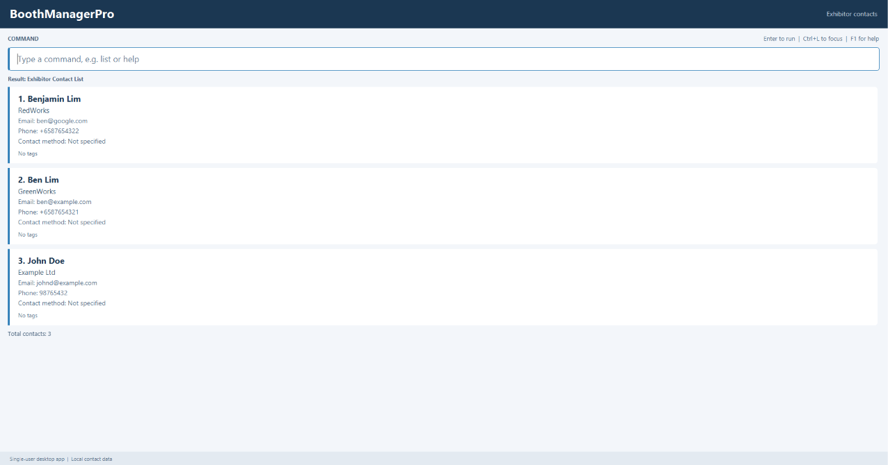

# BoothManagerPro

**Manage exhibitor contacts efficiently through typed commands.**

BoothManagerPro is a desktop application designed for convention organisers
who manage dozens to hundreds of exhibitor contacts and prefer working
with the keyboard. It combines command-line input with a graphical
interface to make contact information easy to enter and view.

## Why BoothManagerPro?

Keeping track of exhibitor representatives and their contact details can
become difficult as a convention grows. BoothManagerPro brings this
information together in one place, helping organisers quickly find the
right person and maintain organised contact records.

## About the project

BoothManagerPro focuses on managing exhibitors and their representatives
throughout the enquiry process, supporting adding, listing, sorting, viewing,
updating, tagging, filtering, and deleting contact records.

Contacts record an enquiry status, preferred contact method, and an optional follow-up date.
Use `update NAME_OR_INDEX s/STATUS f/YYYYMMDD` to modify these fields, and `tag` to toggle tags.
Use `find f/YYYYMMDD` for an exact follow-up date, or `find f/today`, `find f/due`, and `find f/overdue` for relative date filtering. Due includes today and earlier dates; overdue excludes today. These searches do not imply an enquiry status. Date ranges and automatic reminders remain planned.

## UI preview

*BoothManagerPro displaying contacts as static contact cards with coloured enquiry status badges. Startup displays a ready prompt, and `list`, `find`, and `view` render contacts directly in the single scrollable output area.*

## Who it is for

BoothManagerPro is designed for organisers at convention centres who need to keep track of exhibitors they have invited and their representatives' contact details.
Used to track contact details, it is best suited to organisers who:

* handle dozens to hundreds of potential exhibitors, often with several representatives from the same exhibitor
* frequently update contact details and use tags to organise exhibitors
* need to pull up an exhibitor's contact details quickly, such as while on a call or replying to an email
* are comfortable with computers and prefer typing commands, as they need to process information quickly
* find full event-management software too slow or complex for day-to-day contact tracking

## Core features

BoothManagerPro centres on these contact-management workflows:

1. **Add:** Save name, company, email, phone, optional contact method, enquiry status, follow-up date, and tags, with validation and duplicate detection.
1. **Delete:** Remove a contact by full name or displayed index; ambiguous names require an index.
1. **List:** Display all contacts and their details, with a total count, optionally sorted by name, company, or enquiry status.
1. **View:** Search by name keywords and select a contact to see its full details.
1. **Update:** Change any contact field, by full name or displayed index.
1. **Tag:** Toggle tags on a contact, by full name or displayed index.
1. **Find and filter:** Match full names or whole name words (`n/`), partial company, email, or phone values (`c/`, `e/`, `p/`), and complete contact method, enquiry status, tag, or follow-up date values (`m/`, `s/`, `t/`, `f/`); alternatives within a field use OR, and different fields use AND.

The `clear` command is also available. See the [User Guide](docs/UserGuide.md) for full syntax and examples.

### Future enhancements

- **CSV import and export:** Bring in existing contacts and share exhibitor lists with colleagues.
- **Undo:** Reverse an accidental action.

## Getting started

To build and run the current development version, see the [development setup guide](docs/SettingUp.md). The [User Guide](docs/UserGuide.md) covers every command, including `update`, `tag`, and list sorting.

## Documentation

- [User Guide](docs/UserGuide.md) - Learn how to use the application.
- [Developer Guide](docs/DeveloperGuide.md) - Understand the architecture and development practices.
- [Development setup](docs/SettingUp.md) - Set up the project to build and run locally.
- [About us](docs/AboutUs.md) - Meet the project team.

## Acknowledgements

This project is based on the [AddressBook-Level3](https://github.com/se-edu/addressbook-level3) project created by the [SE-EDU initiative](https://se-education.org). We acknowledge its code and documentation as the foundation for this application.

## License

This project is licensed under the [MIT License](LICENSE).
