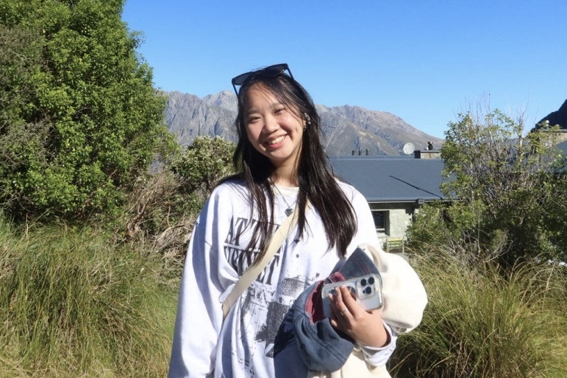
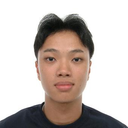
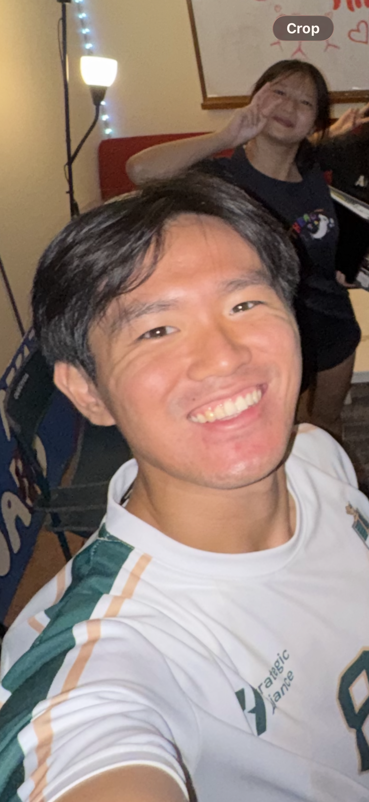
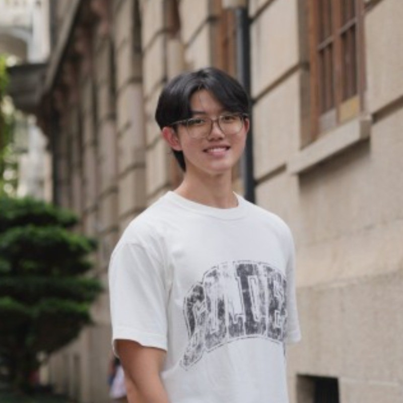
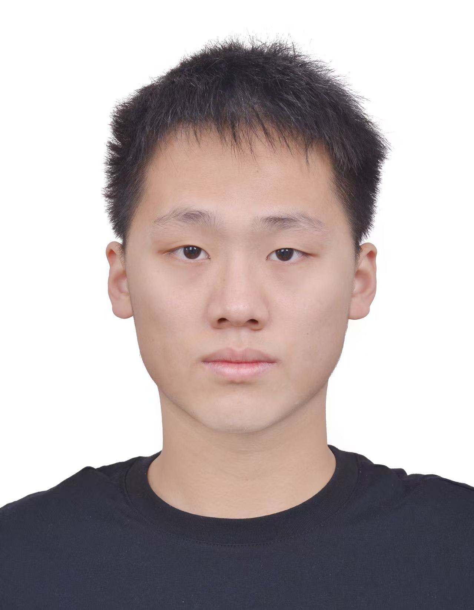

We are a team based in the [School of Computing, National University of Singapore](https://www.comp.nus.edu.sg).

## Project team

### Jenna Ng

[[github](https://github.com/jennangke)]
[[portfolio](team/jennangke.md)]

* Role: Developer
* Responsibilities: Logic & parser error handling

### Rhineson Kok

[[github](https://github.com/rhinesonn)]
[[portfolio](team/rhinesonn.md)]

* Role: Team Lead & Developer
* Responsibilities: Architecture, UI integration & Developer Guide

### Cedric Cheng

[[github](https://github.com/seadrickbug)]
[[portfolio](team/seadrickbug.md)]

* Role: Developer
* Responsibilities: UI & help system

### Gerard Lum

[[homepage](https://www.linkedin.com/in/gerardlumkaien/)]
[[github](https://github.com/gerardlke)]
[[portfolio](team/gerardlke.md)]

* Role: Developer
* Responsibilities: Model & data management

### Li Wenze

[[github](https://github.com/legned-wenze)]
[[portfolio](team/legned-wenze.md)]

* Role: Developer
* Responsibilities: Storage recovery & state management
