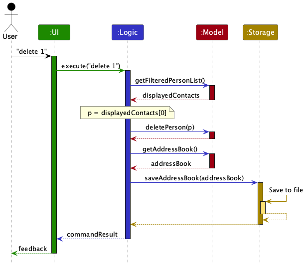
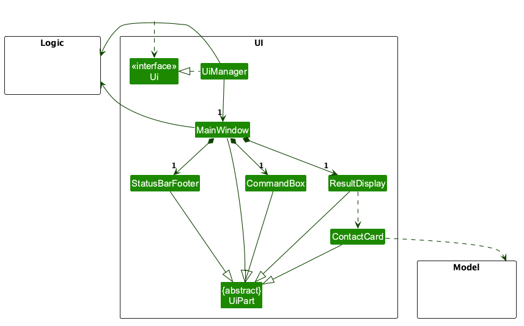
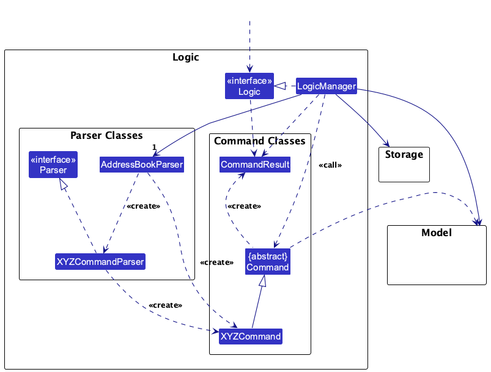
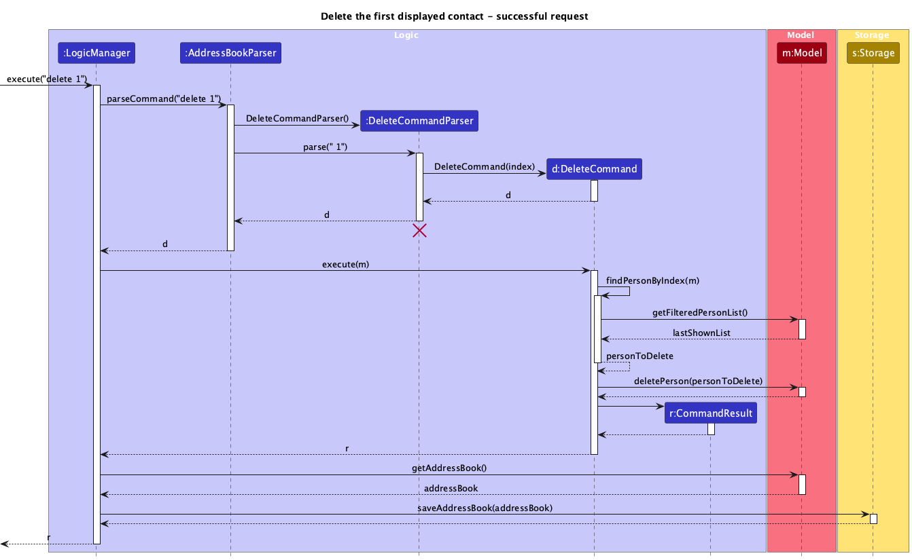
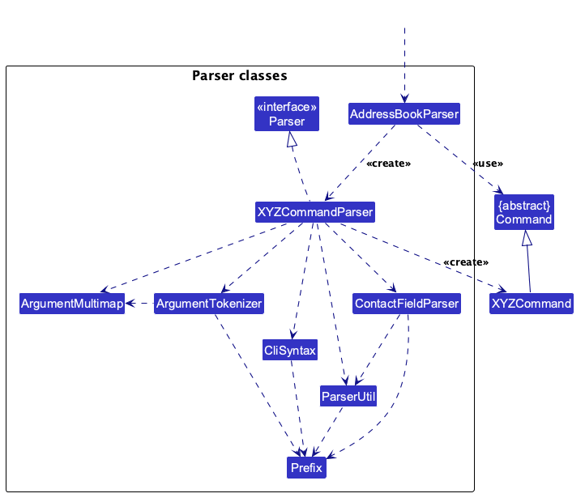
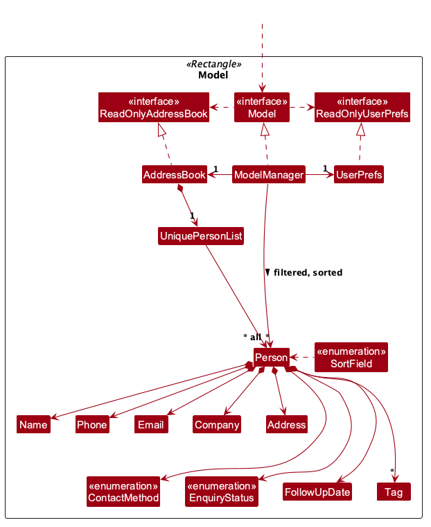
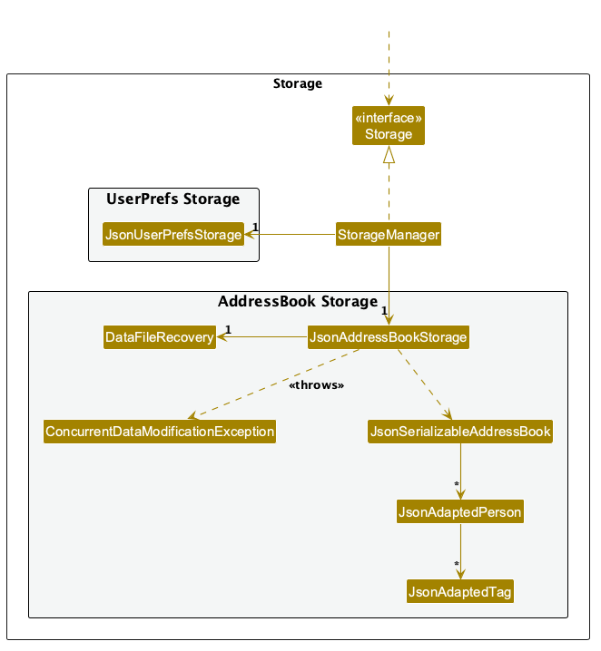
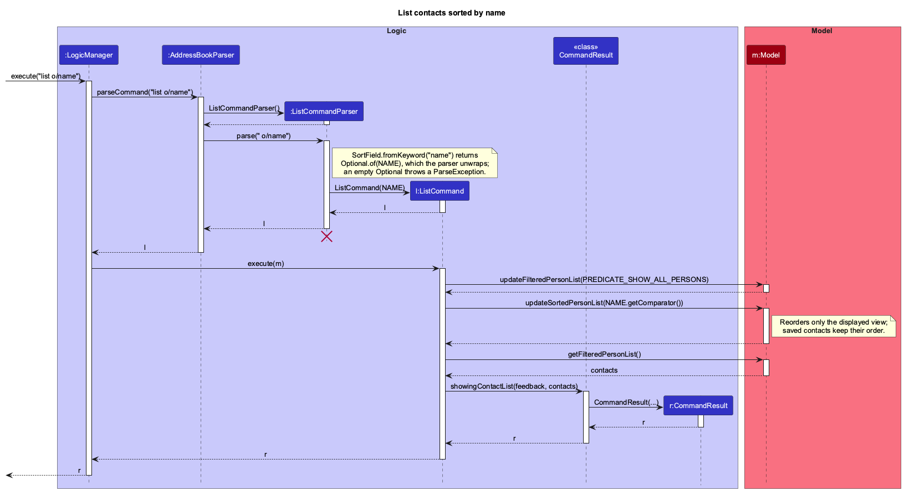
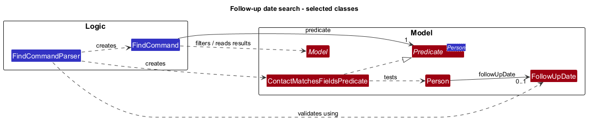
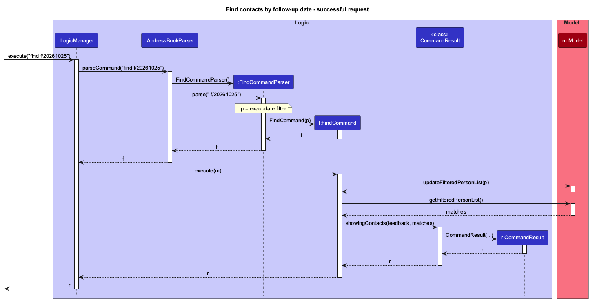

* Table of Contents
{:toc}

--------------------------------------------------------------------------------------------------------------------

## **Acknowledgements**

* _{List the sources of reused or adapted ideas, code, documentation, and third-party libraries here, with links to the originals.}_

--------------------------------------------------------------------------------------------------------------------

## **Setting up, getting started**

Refer to the guide [_Setting up and getting started_](SettingUp.md).

--------------------------------------------------------------------------------------------------------------------

## **Design**

:bulb: **Tip:** The `.puml` files used to create diagrams are in `docs/diagrams`. Refer to the [_PlantUML Tutorial_ at se-edu/guides](https://se-education.org/guides/tutorials/plantUml.html) to learn how to create and edit diagrams.

### Architecture

The ***Architecture Diagram*** given above explains the high-level design of the App.

The following provides a quick overview of the main components and their interactions.

**Main components of the architecture**

**`Main`** (consisting of classes [`Main`](../src/main/java/seedu/boothmanagerpro/Main.java) and [`MainApp`](../src/main/java/seedu/boothmanagerpro/MainApp.java)) is in charge of the app launch and shut down.
* At app launch, it initializes the other components in the correct sequence, and connects them up with each other.
* At shut down, it shuts down the other components and invokes cleanup methods where necessary.

The bulk of the app's work is done by the following four components:

* [**`UI`**](#ui-component): The UI of the App.
* [**`Logic`**](#logic-component): The command executor.
* [**`Model`**](#model-component): Holds the data of the App in memory.
* [**`Storage`**](#storage-component): Reads data from, and writes data to, the hard disk.

[**`Commons`**](#common-classes) represents a collection of classes used by multiple other components.

**How the architecture components interact with each other**

The *Sequence Diagram* below shows how the components interact with each other for the scenario where the user issues the command `delete 1`.

For this command, `Logic` obtains the contacts in their current displayed order from `Model` and resolves `1` to the
first displayed contact. After deleting that contact, `Logic` obtains the updated address book and asks `Storage` to
save it. The resulting `CommandResult` is then returned to `UI`, which displays the feedback to the user.

Each of the four main components (also shown in the diagram above),

* defines its *API* in an `interface` with the same name as the Component.
* provides its functionality through a concrete `{Component Name}Manager` class that implements the corresponding API interface.

For example, the `Logic` component defines its API in `Logic.java` and implements it in `LogicManager.java`. Other components interact with a component through its interface rather than its concrete class, preventing them from coupling to that component's implementation, as illustrated in the following partial class diagram.

The sections below give more details of each component.

### UI component

The **API** of this component is specified in [`Ui.java`](../src/main/java/seedu/boothmanagerpro/ui/Ui.java)

The command interface is composed of `MainWindow`, `CommandBox`, `ResultDisplay`, and `StatusBarFooter`. Help is printed in the same output area.

The UI consists of a `MainWindow` and its parts, such as `CommandBox`, `ResultDisplay`, and `StatusBarFooter`. `ResultDisplay` shows the contacts returned by `list`, `find`, and `view` as `ContactCard`s. All of these, including `MainWindow`, inherit from the abstract `UiPart` class, which captures common behavior among classes that represent visible GUI parts.

The `UI` component uses the JavaFX UI framework. The layouts of these UI parts are defined in matching `.fxml` files in `src/main/resources/view`. For example, [`MainWindow.fxml`](../src/main/resources/view/MainWindow.fxml) specifies the layout of [`MainWindow`](../src/main/java/seedu/boothmanagerpro/ui/MainWindow.java).

The `UI` component,

* executes user commands using the `Logic` component.
* displays the text returned by `Logic.execute()` after each command.
* keeps a reference to the `Logic` component, because the `UI` relies on the `Logic` to execute commands.
* delegates contact formatting to the logic layer; it does not render `Person` objects as cards.

#### UI extension points

| Component | Responsibility |
| --- | --- |
| `MainWindow.fxml` / `BoothManagerPro.css` | Command-only layout, colours, spacing, and an output area that fills available space. |
| `ContactCard.fxml` / `ContactCard` | A static card for one contact, shown by `ResultDisplay` when a `CommandResult` carries contacts to show. The enquiry status appears as a badge beside the name; `ContactCard` adds a `status-*` style class (e.g. `status-in-progress`) to the badge and card, and `BoothManagerPro.css` colours both. |
| `CommandBox` | Typed input through `Logic.execute()`; successful input clears, failed input remains editable. |
| `ResultDisplay` | Read-only text output, summary heading, and error styling. Each result replaces the previous output. |

- Startup prints only a ready prompt; contacts are loaded into the model without being printed.
- There are no graphical contact-list or details panels, no contact selection listeners, and no visibility flag.
- `list` and `find` print numbered contacts; `view` prints details or numbered choices.
- Enter executes, Ctrl+L (Command+L on macOS) focuses command input, and F1 prints help.
- `MainWindowTest` checks FXML, text output, filtered indices, keyboard controls, persistence, and the absence of contact panels. It writes previews to `build/reports/ui/`; Linux needs a display such as Xvfb.

### Logic component

**API** : [`Logic.java`](../src/main/java/seedu/boothmanagerpro/logic/Logic.java)

Here's a (partial) class diagram of the `Logic` component. `LogicManager` owns one `AddressBookParser`, which creates
the command-specific parser and command required for the user's input. The concrete command operates on `Model` and
creates a `CommandResult`, while `LogicManager` coordinates persistence through `Storage`.

The sequence diagram below illustrates the interactions within the `Logic` component, taking `execute("delete 1")` API call as an example.

:information_source: **Note:** The lifeline for `DeleteCommandParser` should end at the destroy marker (X), but due to a limitation of PlantUML, it continues to the end of the diagram.

How the `Logic` component works:

1. `LogicManager` passes `delete 1` to `AddressBookParser`. It creates a `DeleteCommandParser`, which parses the
   argument as an `Index` and creates a `DeleteCommand`.
1. `LogicManager` executes the `DeleteCommand` with `Model`.
1. `DeleteCommand` obtains the filtered and sorted contact list from `Model`, resolves the one-based displayed index
   to `personToDelete`, and asks `Model` to delete that `Person`.
1. `DeleteCommand` creates and returns a `CommandResult` containing the deleted contact's details.
1. `LogicManager` obtains the updated address book from `Model` and asks `Storage` to save it.
1. After persistence succeeds, `LogicManager` returns the `CommandResult` to its caller.

Here are the other classes in `Logic` (omitted from the class diagram above) that are used for parsing a user command:

How the parsing works:
* When called upon to parse a user command, the `AddressBookParser` class creates an `XYZCommandParser` (`XYZ` is a placeholder for the specific command name, e.g., `AddCommandParser`). The parser uses the other classes shown above to parse the user command and create an `XYZCommand` object (e.g., `AddCommand`). The `AddressBookParser` returns that object as a `Command` object.
* All `XYZCommandParser` classes, such as `AddCommandParser` and `DeleteCommandParser`, implement the `Parser` interface so they can be treated similarly where appropriate, for example during testing.

### Model component
**API** : [`Model.java`](../src/main/java/seedu/boothmanagerpro/model/Model.java)

The `Model` component,

* stores the address book data i.e., all `Person` objects (which are contained in a `UniquePersonList` object).
* stores the `Person` objects selected by the current filter, such as search results, in a separate _filtered_ list, wrapped in a _sorted_ view that `list o/FIELD` can reorder. It exposes this view as an unmodifiable `ObservableList<Person>` used by commands for filtering, numbered output, and indexed editing/deletion.
* stores a `UserPrefs` object that represents the user’s preferences (currently, just the GUI settings). This is exposed to the outside as a `ReadOnlyUserPrefs` object.
* does not depend on any of the other three components (as the `Model` represents data entities of the domain, they should make sense on their own without depending on other components)

:information_source: **Note:** The alternative, arguably more object-oriented, design below keeps a unique list of tags in `AddressBook`, and each `Person` references tags from that list. This lets `AddressBook` maintain one `Tag` object per unique tag instead of each `Person` holding its own `Tag` objects. 

### Storage component

**API** : [`Storage.java`](../src/main/java/seedu/boothmanagerpro/storage/Storage.java)

The `Storage` component,
* can save both address book data and user preference data in JSON format, and read them back into corresponding objects.
* is implemented by `StorageManager`, which delegates the actual JSON file access to `JsonAddressBookStorage` and `JsonUserPrefsStorage` (one class per data file).

Invalid JSON objects and null contact/tag entries produce controlled loading errors. `MainApp` falls back to an empty contact collection and passes a visible loading warning to the UI; invalid preferences fall back to defaults. Optional legacy contact fields retain their existing defaults.

`JsonAddressBookStorage` records failed loads using `DataFileRecovery`. Before the first subsequent save to that path, it copies the original bytes to a unique `.recovery-` JSON file in the same directory. Backup failure blocks the save and retains recovery protection for a retry. A successful backup or a successful reload clears that protection. Recovery files are never automatically loaded or overwritten; users must close the app and repair/restore data manually. This protection does not coordinate concurrent app instances.
* depends on some classes in the `Model` component (because the `Storage` component's job is to save/retrieve objects that belong to the `Model`)

### Common classes

Classes used by multiple components are in the `seedu.boothmanagerpro.commons` package.

--------------------------------------------------------------------------------------------------------------------

## **Implementation**

### Command-only contact display

`MainWindow` contains a command input and a text result area. Startup prints only a ready prompt. The model
still holds all saved contacts, but there is no contact-list widget, details widget, or persistent visibility state.

`ListCommand` restores the full model filter, applies or clears the sort order, and prints every contact. `FindCommand` updates the filter and prints
the match count plus every matching contact. Both use `Messages.formatNumberedContacts()` so the numbers in
text match the one-based indices accepted by `update`, `tag`, and `delete`. Empty results print a message without records.

`CommandResult` carries text, an exit flag, and an immutable `viewChoices` snapshot when a numbered view reply
is required. It does not carry GUI contact-selection metadata. `MainWindow` sends the returned text to
`ResultDisplay`, which fills the remaining workspace and scrolls for long output. Each command replaces the
previous text; results are not a command-history transcript.

Add, update, and tag reset the model filter, and deletion shifts later indices. Users should run list or find again before
choosing a subsequent index. A restart keeps saved contacts and resets the output to the ready prompt.

Regression tests cover text-only startup/restart, find before list, filtered update/delete indices, view replies,
errors, persistence, and keyboard-only operation. UI snapshots are generated as `build/reports/ui/cli-*.png`.

### Viewing an exhibitor contact

This increment follows the [team MVP feature specification](https://docs.google.com/document/d/1cRh9EyPpK2RwCaOXUsMIc6ls2n8jNccG_jbO2QjzPfw/edit).
It uses `view n/NAME` and a numbered reply for multiple matches. Matching has been refined to behave like the
existing `find` command: case-insensitive whole-name keywords combined with OR. All results appear in the text output area.

`ViewCommandParser` enforces the specified name length and permitted characters, one `n/` field, and no other fields.
`ViewCommand` searches the full address book using the existing `NameContainsKeywordsPredicate` and updates the
filtered list to those matches. It leaves stored contacts unchanged. A unique match returns the formatted details as command feedback.
If exactly one match has a full name equal to the query, ignoring case, `ViewCommand` returns that contact directly
and filters to it, so overlapping names such as `Alex Yeo` and `Alex Yeoh` can each be viewed without a numbered reply.
Multiple matches return a numbered name-and-company list plus an immutable `CommandResult.viewChoices` snapshot.

`LogicManager` retains those choices and their prompt for the next numbered reply. Invalid replies report the valid
range followed by the prompt again, and keep the choices available. A successful selection or another successfully parsed command clears the pending choices,
even if command execution fails. Invalid command syntax preserves the pending choices.
If the selected record has changed or disappeared, the user must run `view` again. Each LogicManager has its own
selection state. Viewing and numbered replies bypass storage writes, because neither changes contact data.

The numbered choice and resulting details both use the same text output area. A new command's feedback replaces
the old choice prompt. No UI selection state or deferred list listener is needed.

#### Shared contact attributes

The five MVP workflows use `Person` and its validated value objects.

| Attribute | Shared contract |
| --- | --- |
| Name | `Name` owns validation: 1-80 Unicode code points, at least one letter, supported punctuation. View uses the same validator as add and prefixed find. |
| Company | `Optional<Company>`; required by add, absent in legacy records. `find c/` matches the complete value ignoring case. |
| Email / phone | Stored lowercase email and normalised phone; search validates through the same value objects as add. |
| Contact method | `Optional<ContactMethod>`; email, phone, or other. An absent method is shown as `Not specified`. Not a search criterion. |
| Tags | Exact duplicates collapse on add. Search ignores case and matches whole tags. Add, update, storage, and command feedback preserve stored order. Empty tags show `None`. |
| Storage | JSON uses `company` and `contactMethod`; absent fields become empty optionals. The legacy address remains for compatibility. |

| Feature | Selection / result |
| --- | --- |
| Add | Rejects normalised-email or case-insensitive name/company duplicates across all records. |
| Delete | Full-name match across all records, or index in the displayed list. Ambiguous names require an index; feedback includes company and method. |
| View | Whole-name keywords with OR; a unique exact full name shows that contact, otherwise multiple matches require a numbered selection. |
| List | Restores every contact and displays all exhibitor attributes plus total; optionally sorts by name, company, or enquiry status (`o/name`, `o/company`, `o/status`); rejects other arguments. |
| Find | Full names or whole name words and complete other field values, OR within each field and AND across fields; unprefixed keywords retain name-word matching. |

Update preserves unmodified fields, rejects unsupported prefixes, and replaces tags in input order.
`Messages.formatContactDetails()` supplies the shared list/view format; `Messages.formatTags()` and
`Messages.formatOptional()` keep text placeholders consistent. Enquiry status and follow-up dates are included in contact details.

Tests cover actual persisted exhibitor records, numbered selection and retries, cancelled/stale choices,
invalid syntax, matching parity with `find`, legacy records, data preservation, and command-only output.
The JavaFX regression test covers same-name contacts at different companies, numbered replies, and cancellation.

This section describes some noteworthy details on how certain features are implemented.

### Updating an exhibitor contact

`update NAME_OR_INDEX [n/NAME] [c/COMPANY] [e/EMAIL] [p/PHONE] [m/METHOD] [s/STATUS] [f/YYYYMMDD] [t/TAG]...`

1. `AddressBookParser` routes to `UpdateCommandParser`, which validates the target, field cardinality and supplied values.
2. `ContactFieldParser` shares prefix-specific validation feedback with add; domain value types remain the source of constraints and normalisation.
3. Immutable `ContactUpdate` represents partial changes. An absent optional preserves the value; a present empty date/tag set explicitly clears it. Tags are defensively copied.
4. `UpdateCommand` resolves a full name across all contacts or an index in the current filtered list. Missing/ambiguous targets fail before mutation.
5. The command constructs a replacement and checks every other contact for duplicate email or name/company, including hidden records. Target resolution, duplicate warnings, and successful updates are logged via `LogsCenter`. Only then does it call `Model.setPerson` and clear the filter.
6. Existing `LogicManager` persistence saves the result; the UI shows a concise confirmation. `view`/`list`/`find` display the new attributes through the existing cards.

Legacy address is preserved. Supplied tags replace the tag set; a sole blank `t/` clears it. Empty `f/` clears the follow-up date. Other empty fields fail validation. There is no new storage schema or persistent contact ID.

`UpdateIntegrationTest` covers command routing, normalisation, partial updates, clearing, duplicate rejection, ambiguity, filtered indices, and persisted JSON. Rejected requests preserve contacts, filters, and disk content. `MainWindowTest` checks confirmation, updated cards, and retained input after invalid updates.

### Updating contact tags

`tag NAME_OR_INDEX t/TAG [t/TAG]...`

1. `AddressBookParser` routes `tag` to `TagCommandParser`, which rejects unsupported prefixes, requires a target and at least one `t/TAG` field, and validates each tag through `ContactFieldParser` and `Tag`. Duplicate `t/TAG` inputs in the same command collapse in input order.
2. `TagCommand` resolves an exact case-insensitive full name across all contacts or a one-based index in the current filtered list, rejecting missing or ambiguous targets before mutation.
3. Each supplied tag is toggled against the contact's existing tag set using `Tag#equals` (case-sensitive): absent tags are appended and recorded as added, while present tags are removed and recorded as removed.
4. The command replaces the contact with all other fields preserved, resets the filtered list, and returns `Updated tags for NAME at COMPANY. Added: .... Removed: .... Current tags: ....` (`None` when a tag list is empty).
5. `TagIntegrationTest` and `MainWindowTest` verify toggling, exact change summaries, target resolution, persistence, and unchanged state on rejection.

### Adding an exhibitor contact

`add n/NAME c/COMPANY e/EMAIL p/PHONE [m/METHOD] [s/STATUS] [f/YYYYMMDD] [t/TAG]...`

1. `AddressBookParser` routes `add` to `AddCommandParser`.
2. The parser rejects unknown prefixes, preambles, repeated non-tag fields, and missing required prefixes.
3. Value objects validate fields, trim names/company, lowercase email, and remove phone spaces/hyphens. Repeated tags are ignored.
4. `AddCommand` checks the complete address book for matching email or name/company, logging execution, duplicate rejections, and successful additions via `LogsCenter`, then adds the contact or reports the existing match.
5. `LogicManager` saves through `JsonAddressBookStorage` before returning the success result.
6. The result contains a concise identity confirmation. `MainWindow` prints it and focuses command input. `CommandBox` clears successful input and retains failed input. A later `view`, `find`, or `list` prints the saved details.

Enquiry fields:

- `EnquiryStatus` validates the four case-insensitive labels; omission defaults to `NEEDS_FOLLOW_UP`.
- `FollowUpDate` wraps `LocalDate`, validates real calendar dates in `YYYYMMDD` (years 0001-9999), and accepts past dates. Omission is `Optional.empty()`. No time or timezone is stored.
- JSON stores `enquiryStatus` as its display label and `followUpDate` as a date string or null. Missing/null fields in older files receive the defaults; invalid non-null values are rejected.
- The `update` command changes status/date; empty `f/` clears the date. No transition order is enforced.
- Neither field changes duplicate identity. List/find/view output and contact cards display both fields.

Error-handling responsibilities:

- **Parser:** tokenises, checks structure, then converts values. Missing/repeated prefixes are grouped by error type in a stable order; empty and invalid values identify their prefix.
- **Value objects:** own validation and normalisation. `parseValue` invokes the same constructors used by storage and adds field context to constraint messages.
- **Model:** `Person.createExhibitor()` owns the legacy address default; the collection independently enforces uniqueness.
- **Command:** collects every duplicate before addition. One match retains the existing warning; multiple matches list each identity/email. Parse and duplicate rejection preserve contacts, the filter, and saved JSON.
- **Storage:** converts validated contacts to and from JSON.

Integration notes:

- `Person.getCompany()` and `getContactMethod()` return optional values. New additions require company; legacy records may lack it. Omitted method displays as `Not specified`.
- Name/company duplicate matching ignores case; contacts without a company match only by normalised email.
- The legacy address field remains for compatibility, using `Not provided` for new contacts. `add` no longer accepts `a/`.
- Prefix-like tokens are reserved. Other words between prefixes belong to that field, allowing multi-word names and companies.
- JSON includes `company` and `contactMethod`; legacy files without them are accepted if their other values meet current validation rules.
- List, find, and view text includes company and contact method. Logic tests run without a display server.

Verification: see [automated add tests](Testing.md#testing-exhibitor-additions) and [manual add checks](#testing-exhibitor-additions). These cover US-01, US-05, US-07, US-16, and US-18 for the add workflow.

### Sorting the contact list

`list o/name`, `list o/company`, and `list o/status` sort the displayed contacts. Plain `list` shows them in stored order, which is
the order they were added.

**How it works**

1. `AddressBookParser` passes the arguments of `list` to `ListCommandParser`. Blank arguments produce a `ListCommand`
   with no sort field. Otherwise, the parser tokenises `o/`, rejects any preamble or repeated `o/`, and converts the
   value to a `SortField` with `SortField.fromKeyword()`, ignoring case. Unknown values are rejected with
   `SortField.MESSAGE_CONSTRAINTS`.
2. `ListCommand#execute()` clears the filter, then calls `Model#updateSortedPersonList(comparator)` for a sort field,
   or `Model#resetPersonListOrder()` for plain `list`.
3. `ModelManager` wraps its `FilteredList` in a JavaFX `SortedList`. `getFilteredPersonList()` returns the sorted
   view, so every command that reads indices, such as `delete`, `tag`, and `update`, uses the order the user sees.
   A `null` comparator keeps the stored order.

The sequence diagram below shows how `list o/name` is executed.

`SortField` defines each order as a `Comparator<Person>`:

| Field | Order |
| --- | --- |
| `NAME` | Name ignoring case, then company (contacts without a company last), then email. |
| `COMPANY` | Company ignoring case with contacts without a company last, then name, then email. |
| `STATUS` | Enquiry status in workflow order (the declaration order of `EnquiryStatus`: Needs follow-up, In progress, Completed, Cancelled), then name, then email. |

Email is unique per contact, so the final email comparison means no two contacts tie and the displayed indices are
stable between runs.

Status uses workflow order rather than alphabetical order, which would place `Completed` first. Adding a new
`EnquiryStatus` value therefore needs it declared in the right position to sort correctly.

The comparator stays on the `SortedList` until the next plain `list`. Filters from `find` and `view`, and the filter
reset after `add`, `update`, and `tag`, apply beneath it, so their results keep the chosen order.

**Design considerations**

* **Alternative 1 (current choice):** Sort a view of the filtered list.
  * Pros: Saved data and the "date added" order are untouched. Indices always match the displayed order.
  * Cons: The sort order is session state that later commands inherit, which users need to be told about.
* **Alternative 2:** Sort the `UniquePersonList` in `AddressBook`.
  * Pros: Simple, with no extra model state.
  * Cons: Changes the saved file order and permanently loses the order in which contacts were added.
* **Alternative 3:** Sort only the output inside `ListCommand`.
  * Pros: No model changes.
  * Cons: Displayed numbers would no longer match the indices used by `delete`, `tag`, and `update`.

### \[Proposed\] Undo/redo feature

This section is a design proposal only. `VersionedAddressBook`, `UndoCommand`, `RedoCommand`, and the history methods below do not exist in the current code.

#### Proposed Implementation

The proposed undo/redo mechanism is facilitated by `VersionedAddressBook`. It extends `AddressBook` with an undo/redo history, stored internally as an `addressBookStateList` and `currentStatePointer`. Additionally, it implements the following operations:

* `VersionedAddressBook#commit()` — Saves the current address book state in its history.
* `VersionedAddressBook#undo()` — Restores the previous address book state from its history.
* `VersionedAddressBook#redo()` — Restores a previously undone address book state from its history.

The proposal would expose these operations in the `Model` interface as `Model#commitAddressBook()`, `Model#undoAddressBook()` and `Model#redoAddressBook()` respectively.

Given below is an example usage scenario and how the undo/redo mechanism behaves at each step.

Step 1. The user launches the application for the first time. The `VersionedAddressBook` will be initialized with the initial address book state, and the `currentStatePointer` pointing to that single address book state.

Step 2. The user executes `delete 5` command to delete the 5th person in the address book. The `delete` command calls `Model#commitAddressBook()`, causing the modified state of the address book after the `delete 5` command executes to be saved in the `addressBookStateList`, and the `currentStatePointer` is shifted to the newly inserted address book state.

Step 3. The user executes `add n/David …​` to add a new person. The `add` command also calls `Model#commitAddressBook()`, causing another modified address book state to be saved into the `addressBookStateList`.

:information_source: **Note:** If a command fails its execution, it will not call `Model#commitAddressBook()`, so the address book state will not be saved into the `addressBookStateList`.

Step 4. The user now decides that adding the person was a mistake, and decides to undo that action by executing the `undo` command. The `undo` command will call `Model#undoAddressBook()`, which will shift the `currentStatePointer` once to the left, pointing it to the previous address book state, and restores the address book to that state.

:information_source: **Note:** If the `currentStatePointer` is at index 0, pointing to the initial AddressBook state, then there are no previous AddressBook states to restore. The `undo` command uses `Model#canUndoAddressBook()` to check if this is the case. If so, it will return an error to the user rather
than attempting to perform the undo.

The following sequence diagram shows how an undo operation goes through the `Logic` component:

:information_source: **Note:** The lifeline for `UndoCommand` should end at the destroy marker (X), but due to a limitation of PlantUML, it continues to the end of the diagram.

Similarly, how an undo operation goes through the `Model` component is shown below:

The `redo` command does the opposite — it calls `Model#redoAddressBook()`, which shifts the `currentStatePointer` once to the right, pointing to the previously undone state, and restores the address book to that state.

:information_source: **Note:** If the `currentStatePointer` is at index `addressBookStateList.size() - 1`, pointing to the latest address book state, then there are no undone AddressBook states to restore. The `redo` command uses `Model#canRedoAddressBook()` to check if this is the case. If so, it will return an error to the user rather than attempting to perform the redo.

Step 5. The user then decides to execute the command `list`. Commands that do not modify the address book, such as `list`, will usually not call `Model#commitAddressBook()`, `Model#undoAddressBook()` or `Model#redoAddressBook()`. Thus, the `addressBookStateList` remains unchanged.

Step 6. The user executes `clear`, which calls `Model#commitAddressBook()`. Since the `currentStatePointer` is not pointing at the end of the `addressBookStateList`, all address book states after the `currentStatePointer` will be purged. Reason: It no longer makes sense to redo the `add n/David …​` command. This is the behavior that most modern desktop applications follow.

The following activity diagram summarizes what happens when a user executes a new command:

#### Design considerations:

**Aspect: How undo & redo execute:**

* **Alternative 1 (current choice):** Saves the entire address book.
  * Pros: Easy to implement.
  * Cons: May have performance issues in terms of memory usage.

* **Alternative 2:** Individual command knows how to undo/redo by
  itself.
  * Pros: Will use less memory (e.g. for `delete`, just save the person being deleted).
  * Cons: We must ensure that the implementation of each individual command is correct.

_{more aspects and alternatives to be added}_

### \[Proposed\] Data archiving

_{Explain here how the data archiving feature will be implemented}_

--------------------------------------------------------------------------------------------------------------------

## **Documentation, logging, testing, dev-ops**

* [Documentation guide](Documentation.md)
* [Testing guide](Testing.md)
* [Logging guide](Logging.md)
* [DevOps guide](DevOps.md)

--------------------------------------------------------------------------------------------------------------------

## **Appendix: Requirements**

### Product scope

#### Target user profile

* Convention organisers managing many exhibitor representatives
* Comfortable typing commands for repeated contact-management tasks
* Need to store and retrieve contact information quickly

**Value proposition:** Manage exhibitor contacts through typed commands, with clear feedback and local storage. Contacts can record enquiry status and an optional follow-up date during addition. Startup prints no contacts; list, find, and view print requested results as text.

### User stories

<!-- Owner: Gerard. Keep story IDs stable for cross-references. -->

Planned requirements for BoothManagerPro; implementation status is tracked separately. Here, **organiser** means convention organiser.

**Priorities:** `***` High (must have), `**` Medium (should have), `*` Low (nice to have).

- Priorities follow the feature list and explicit MVP requirements.
- Considered stories are candidates, not commitments.
- Out-of-scope stories are excluded regardless of priority.

#### Planned user stories

| ID | Priority | As a... | I want to... | So that... |
| --- | --- | --- | --- | --- |
| US-01 | `***` | organiser | add a representative's name, company, email, and phone | I have their essential contact details. |
| US-02 | `***` | organiser | delete outdated contacts | my records stay relevant. |
| US-03 | `***` | organiser | list all exhibitor contacts | I can review my records. |
| US-04 | `***` | organiser | view a contact's full details | I can contact the right representative. |
| US-05 | `***` | organiser | have duplicate contacts rejected with an explanation | I avoid repeated records. |
| US-06 | `***` | organiser | distinguish same-name contacts when viewing or deleting | I select the correct record. |
| US-07 | `***` | organiser | see clear errors for missing or invalid fields | I can correct my input. |
| US-08 | `**` | first-time organiser | see features and usage instructions | I know how to begin. |
| US-09 | `**` | organiser | update contact details | my records stay accurate. |
| US-10 | `**` | organiser | find contacts by full names or whole name words, company, email, or phone | I can locate contacts quickly. |
| US-11 | `**` | organiser | filter contacts by enquiry status | I can review each enquiry stage. |
| US-12 | `**` | organiser | combine search fields and alternatives | I can narrow my results. |
| US-13 | `**` | organiser | set enquiry status to Needs follow-up, In progress, Completed, or Cancelled | I can track progress. |
| US-14 | `**` | organiser | set a next follow-up date | I know when to contact someone again. |
| US-15 | `**` | organiser | view due or overdue follow-ups | I can prioritise outreach. |
| US-16 | `**` | organiser | tag contacts by industry, priority, or need | I can group exhibitors. |
| US-17 | `**` | organiser | filter contacts by tags | I can retrieve relevant groups. |
| US-18 | `**` | organiser | record a preferred contact method | I can use the appropriate channel. |
| US-36 | `**` | organiser | sort the contact list by name, company, or enquiry status | I can scan contacts in a predictable order and see who needs follow-up first. |

- **US-05:** Duplicates share a normalised email or a name-and-company combination.
- **US-11:** Enquiry-status filtering is planned. `list o/status` sorts all contacts by status; it does not filter them.
- **US-12:** Repeated values within a field use OR; different fields use AND.
- **US-15:** `find f/YYYYMMDD` matches one exact follow-up date, including a date supplied by the user for today. It does not automatically select today or include earlier dates. Automatic due or overdue filtering remains planned.

#### Considered user stories

| ID | Priority | As a... | I want to... | So that... | Scope note |
| --- | --- | --- | --- | --- | --- |
| US-19 | `*` | organiser | import contacts from CSV | I avoid manual entry. | Optional enhancement. |
| US-20 | `*` | organiser | export contacts to CSV | I can share records. | Optional enhancement. |
| US-21 | `*` | organiser | undo my last change | I can recover from mistakes. | Optional enhancement. |
| US-22 | `**` | organiser | record notes and booth requirements | I retain context for follow-ups. | Behaviour to be defined. |
| US-23 | `**` | organiser | link representatives from one organisation | I understand their relationships. | Beyond recording company names. |
| US-24 | `**` | organiser | mark a primary contact | I know whom to contact first. | Outside the selected feature list. |
| US-25 | `**` | organiser | record a confirmed exhibitor's booth number | I can reference their allocation. | Metadata only. |
| US-26 | `**` | fellow organiser | see who last contacted an exhibitor and when | I avoid duplicate outreach. | Contact-history design needed. |
| US-27 | `*` | sales team member | export confirmed exhibitors | I can prepare invoices elsewhere. | Depends on CSV export. |
| US-28 | `*` | operations staff member | receive exhibitor lists with booth numbers | I can plan services elsewhere. | Depends on export and booth metadata. |
| US-29 | `**` | system maintainer | back up and restore records | I can recover lost data. | Recovery design needed. |

#### Out-of-scope user stories

| ID | Priority | As a... | I want to... | So that... | Reason excluded |
| --- | --- | --- | --- | --- | --- |
| US-30 | `*` | compliance officer | control data access and exports | I can restrict sharing. | Multi-user permissions outside scope. |
| US-31 | `*` | organiser | design floor plans and allocate booths spatially | I can plan the layout. | Floor-plan management outside scope. |
| US-32 | `*` | sales team member | invoice exhibitors and process payments | I can collect booth fees. | Financial workflows outside scope. |
| US-33 | `*` | organiser | manage exhibitor contracts | I can administer agreements. | Contract management outside scope. |
| US-34 | `*` | organiser | sell tickets and manage admission | I can run registration. | Ticketing outside scope. |
| US-35 | `*` | operations staff member | schedule venue services and equipment | I can coordinate operations. | Logistics outside scope. |

Exhibitors benefit from accurate statuses and follow-ups (US-13 to US-15); they are not direct application users.

### Use cases

For all use cases below, the **System** is **BoothManagerPro** and the **Actor** is a **convention organiser**.
**Precondition:** The application is running.

A contact represents an exhibitor or an exhibitor representative.
**MSS** means **Main Success Scenario**; **extensions** describe alternative or unsuccessful interactions.

UC01–UC04 describe implemented workflows. UC05 distinguishes current search behavior from planned status filtering. Refer to the [User Guide](UserGuide.md) for supported commands.
**Interaction rule:** All contact actions use typed commands. List, find, and view show their contacts as static, non-interactive cards in the one output area; other results are text. There are no separate contact panels and no automatic startup listing.
**Guarantee:** Input-validation and duplicate rejections leave contacts unchanged. A storage-write failure is reported, but an already executed change may remain in memory; it is not guaranteed to have been saved.

#### UC01: Add an exhibitor contact

**MSS**

1. Organiser requests to add a contact, supplying the name, company, email, phone, and any optional contact method or tags.
2. BoothManagerPro adds the contact and prints a confirmation containing its name and company.

Use case ends.

**Extensions**

* 1a. A required field is missing or a supplied value is invalid.
  * 1a1. BoothManagerPro explains the input error and rejects the request.

  Use case resumes at step 1.

* 1b. A contact with the same normalised email address or the same combination of name and company already exists.
  * 1b1. BoothManagerPro rejects the new contact and identifies the possible duplicate.

  Use case ends.

* 1c. The request contains an unsupported field, an unprefixed value, or a repeated field other than tags.
  * 1c1. BoothManagerPro explains the input error and rejects the request.

  Use case resumes at step 1.

#### UC02: View an exhibitor contact

**MSS**

1. Organiser requests to view a contact by name.
2. BoothManagerPro displays the matching contact's name, company, email, phone, preferred contact method, and tags.

Use case ends.

**Extensions**

* 1a. The name is missing or invalid.
  * 1a1. BoothManagerPro explains the input error.

  Use case resumes at step 1.

* 1b. No contact matches the supplied name, including when there are no stored contacts.
  * 1b1. BoothManagerPro informs the organiser that no matching contact was found.

  Use case resumes at step 1.

* 1c. More than one contact matches the supplied name.
  * 1c1. BoothManagerPro displays the matching contacts with their companies and asks the organiser to select one.
  * 1c2. Organiser types the corresponding number for the intended contact.
  * 1c3. If the selection is invalid, BoothManagerPro explains the valid choices and requests another selection.

  Steps 1c2 to 1c3 repeat until a valid contact is selected.

  Use case resumes at step 2 for the selected contact.

* 1d. The view request contains an unsupported field, an unprefixed value, or a repeated name field.
  * 1d1. BoothManagerPro rejects the request and explains the accepted request format.

  Use case resumes at step 1.

#### UC03: Delete an exhibitor contact

**MSS**

1. Organiser requests to delete a contact using its displayed index.
2. BoothManagerPro resolves the index against the contacts in their current displayed order.
3. BoothManagerPro deletes the selected contact and saves the updated contact data.
4. BoothManagerPro displays the deleted contact's details.

Use case ends.

**Extensions**

* 1a. The argument is missing or is neither a valid name nor a positive integer.
  * 1a1. BoothManagerPro explains the input error.

  Use case resumes at step 1.

* 1b. Organiser supplies a full name instead of an index.
  * 1b1. BoothManagerPro searches all stored contacts for an exact full-name match, ignoring letter case.
  * 1b2. Exactly one contact matches.

  Use case resumes at step 3 for the matching contact.

* 1b1a. No contact matches the supplied full name, including when there are no stored contacts.
  * 1b1a1. BoothManagerPro informs the organiser that no matching contact was found.

  Use case resumes at step 1.

* 1b1b. More than one contact matches the supplied full name.
  * 1b1b1. BoothManagerPro rejects the deletion and asks the organiser to use a displayed index.
  * 1b1b2. Organiser runs `list`, optionally followed by `find`, to identify the intended contact.
  * 1b1b3. Organiser enters `delete INDEX` using its displayed index.

  Use case resumes at step 2. A bare number is not a delete confirmation.

* 2a. The supplied index is outside the currently displayed list.
  * 2a1. BoothManagerPro reports that the displayed index is invalid and does not delete or save anything.

  Use case resumes at step 1.

#### UC04: List exhibitor contacts

**MSS**

1. Organiser requests to list all exhibitor contacts, optionally sorted by name, company, or enquiry status.
2. BoothManagerPro displays all stored contacts with their names, companies, emails, phones, preferred contact methods,
   and tags, in the requested order or in the order they were added, followed by the total number of contacts.

Use case ends.

**Extensions**

* 1a. The organiser supplies parameters other than a single sort field of name, company, or status.
  * 1a1. BoothManagerPro rejects the request and explains the accepted sort fields.

  Use case resumes at step 1.

* 1b. There are no stored contacts.
  * 1b1. BoothManagerPro informs the organiser that no contacts were found and suggests using the add command to add one.

  Use case ends.

#### UC05: Find and filter contacts

**Current implementation (v1.5 development):** `find` supports full names or whole name words (`n/`), and complete
company (`c/`), email (`e/`), phone (`p/`), tag (`t/`), and follow-up date (`f/YYYYMMDD`) criteria,
with OR within a field and AND between fields.
`ContactMatchesFieldsPredicate` applies these criteria to the full address book through the existing model filter.
Name, company, and tag criteria use per-code-point case folding consistent with `String.equalsIgnoreCase`.
Only name criteria normalise repeated whitespace. Stored company/tag spelling is preserved.
Unprefixed name keywords retain AB3's original word-matching behaviour for compatibility. A match count and numbered
matching contacts are printed directly, without requiring a preliminary `list` command.
Enquiry-status criteria remain planned; the parser rejects `s/` and `m/`. The following use case describes the intended full scope.

For date criteria, `FindCommandParser` reuses `FollowUpDate` via the shared field parser to reject invalid calendar
dates before applying a filter. `ContactMatchesFieldsPredicate` compares the canonical date string with the
contact's optional follow-up date; an absent date never matches. Repeated dates are deduplicated and use OR,
while a date combined with company/name/tag or another field uses AND. Existing sorted output and displayed
indices are preserved. No new command, storage field, or file format is introduced. Date changes and clearing
remain owned by the existing `update` implementation; subsequent searches reflect the saved value.

`FindFollowUpDateParserTest` covers date boundaries, leap years, repeated dates, invalid formats, and empty values.
`FindFollowUpDateIntegrationTest` covers exact/combined matches, no results, undated legacy contacts, sorted
update/delete indices, preservation on rejected input, and update/clear followed by JSON reload and date search.

The class diagram below shows the main classes involved in follow-up-date search. `FindCommandParser` validates
date criteria using `FollowUpDate` and creates a `FindCommand` with a predicate. `ContactMatchesFieldsPredicate`
implements `Predicate<Person>`; contacts without a follow-up date do not match a date criterion.

The sequence diagram illustrates a successful `find f/20261025` request. The command updates the filtered
contact list and returns the matching contacts. Shared validation helpers, predicate evaluation, result formatting
and unchanged `LogicManager` housekeeping/storage calls are omitted for clarity.

**MSS**

1. Organiser requests to find contacts using one or more names, companies, emails, phone numbers, enquiry statuses, or tags.
2. BoothManagerPro reports the number of matching contacts and filters the contact index set. Each match is printed
   in the text output with its index and contact details.

Use case ends.

**Matching rules**

* Values for the same field are combined using OR; criteria for different fields are combined using AND.
* Name criteria match a complete name or a single whole name word; other fields match complete values.
  Name and company comparisons ignore case and leading/trailing spaces.
  Email comparisons ignore case and use normalised addresses; phone comparisons ignore spaces and hyphens.
  Status and tag comparisons ignore case.
* Repeated identical search values are ignored.

**Extensions**

* 1a. No search field is supplied.
  * 1a1. BoothManagerPro rejects the request and asks the organiser to provide at least one search field.

  Use case resumes at step 1.

* 1b. A search field is supplied without a value.
  * 1b1. BoothManagerPro rejects the request and explains that search values cannot be empty.

  Use case resumes at step 1.

* 1c. An enquiry status is not one of the supported values.
  * 1c1. BoothManagerPro rejects the request and explains that the supported statuses are Needs follow-up, In progress, Completed, and Cancelled.

  Use case resumes at step 1.

* 1d. Another search value does not meet the specified format for its field.
  * 1d1. BoothManagerPro rejects the request and explains that the value does not match the required format.

  Use case resumes at step 1.

* 1e. The request contains an unknown prefix or an unprefixed value.
  * 1e1. BoothManagerPro rejects the request and explains that every search value must use a supported field prefix.

  Use case resumes at step 1.

* 1f. No contacts match the search criteria.
  * 1f1. BoothManagerPro informs the organiser that no matching exhibitor contacts were found.

  Use case ends.

### Non-Functional Requirements

These are requirements for the intended product, not claims that every target has already been implemented or tested.

1. **Platform compatibility:** The application shall run on Windows, Linux, and macOS with Java `25` installed, without requiring another Java version or OS-specific software.
2. **Portable distribution:** The application shall be distributed as a single JAR and shall not require an installer. The distributed JAR shall not exceed 100 MB.
3. **Single-user, offline operation:** The application shall serve one convention organiser on their own computer. Core contact-management operations shall work without an Internet connection, a user account, or a remote server. Concurrent multi-user access and shared live data files are outside scope.
4. **Local, human-editable storage:** Contact data shall be stored locally in a human-editable text format such as JSON, without a DBMS. Successfully saved records shall remain available after a normal shutdown and restart.
5. **Performance:** The application should support at least 1,000 exhibitor contacts. As a proposed acceptance target, typical add, list, view, delete, and search operations should display their result within two seconds of command submission with a representative 1,000-contact dataset. Record the test machine specifications when measuring this target.
6. **Keyboard usability:** All core contact-management operations shall be accessible through typed commands. An organiser who types faster than average should be able to perform repeated contact-management tasks efficiently without switching to the mouse. This requirement concerns application operations, not OS window controls.
7. **Clear feedback and data integrity:** Invalid commands shall identify the input problem and leave stored contacts unchanged. Storage read/write failures shall be reported rather than presented as successful saves. Command feedback shall distinguish successful operations, invalid input, and empty search results.
8. **Display compatibility:** The GUI shall work without resolution-related inconvenience at 1920 x 1080 or higher with 100% and 125% scaling, and remain usable at 1280 x 720 or higher with 150% scaling, as required by the course screen-resolution constraint.
9. **Data minimisation:** Stored information shall be limited to exhibitor contact and enquiry-management needs. The application shall not require unrelated sensitive information such as identity-document numbers or payment-card details.

### Glossary

* **Booth allocation**: The process of assigning booths to exhibitors, from first enquiry through to confirmation
* **CLI (Command Line Interface)**: A way of using the application by typing text commands instead of clicking through menus
* **Company**: The exhibitor organisation a contact belongs to. Also called *organisation*; this project uses *company*
* **Contact**: A single record in the address book representing one exhibitor representative. Also called *client* or *person*; this project uses *contact*
* **In progress**: An enquiry currently being handled by the organiser
* **Convention organiser**: The primary user of the application: a person at a convention centre who manages exhibitor enquiries and booth allocation. Also referred to as *organiser*
* **CSV (Comma-Separated Values)**: A plain-text file format for tabular data, used to import and export contact lists
* **Duplicate (possible duplicate)**: A contact with the same normalised email address, or the same name and company, as an existing contact. Does not mean two contacts that merely share a name
* **Enquiry**: An exchange between an organiser and an exhibitor about the exhibitor taking part in a convention
* **Enquiry status**: The stage an exhibitor's enquiry has reached: `Needs follow-up`, `In progress`, `Completed`, or `Cancelled`. Also referred to as *status*
* **Exhibitor**: An organisation that is interested in, or has been invited to, take a booth at a convention
* **Exact match**: A search result where the search value matches the complete field value after its field-specific normalisation, not just part of it. For example, `find c/Tech` does not match company "TechNova". Name criteria additionally accept a whole name word, so `find n/Alicia` matches "Alicia Tan".
* **Index**: The number shown beside a contact in a displayed list, used to select a specific contact when several share the same name
* **Mainstream OS**: Windows, Linux, Unix, and macOS
* **Normalisation**: Converting input to a standard form before storing or comparing it, such as lowercasing emails, collapsing repeated spaces in names, and removing spaces and hyphens from phone numbers
* **Prefix**: A marker ending in `/` that identifies which field a value belongs to, e.g. `n/` for name or `t/` for tag
* **Primary contact**: The representative to contact first when an exhibitor has several representatives
* **Representative**: A person who acts on behalf of an exhibitor. One exhibitor may have several
* **Tag**: A short label attached to a contact to group it beyond enquiry status, for example by industry or priority
* **User**: The person operating BoothManagerPro (the convention organiser). Does not refer to the contacts stored in the app

## **Appendix: Instructions for manual testing**

Given below are instructions to test the app manually.

:information_source: **Note:** These instructions only provide a starting point for testers to work on;
testers are expected to do more *exploratory* testing.

### Launch and shutdown

1. Initial launch

   1. Build `build/libs/boothmanagerpro.jar` using the [setup instructions](UserGuide.md#quick-start) and copy it into an empty folder.

   1. In a terminal in that folder, run `java -jar boothmanagerpro.jar`. 
      Expected: The command window opens with a ready prompt and no printed contacts or contact panels.
      Sample contacts are still loaded; `list` displays them. The window size may not be optimal.

1. Saving window preferences

   1. Resize the window to an optimal size. Move the window to a different location. Close the window.

   1. Relaunch the app with `java -jar boothmanagerpro.jar` from the same folder. 
       Expected: The most recent window size and location are retained when they fit an available screen. Off-screen positions are moved onto an available screen, and oversized windows are resized to fit.

1. _{ more test cases …​ }_

### Testing command-only output

Use a disposable data folder. Do not run `clear` against real contact data.

| Scenario | Steps | Expected |
| --- | --- | --- |
| Populated startup | Launch with saved contacts. | A ready prompt appears. No contacts are printed and no contact panels exist. |
| Invalid request | Try `list extra`, `find`, or `view n/NobodyMatches`. | Error text replaces the output; input remains for correction and data is unchanged. |
| Add | Add a valid contact. | Brief identity confirmation only; `view` can print its details. |
| Show all | Run `list`. | Every contact is printed with an index and details, followed by the total. |
| Sort | Run `list o/name`, `list o/company`, then `list o/status`. | Contacts appear alphabetically by name, then by company with contacts without a company last, then by status with `Needs follow-up` first and `Cancelled` last. The heading names the sort field. |
| Sorted indices | After `list o/name`, run `delete 1`. | The first contact alphabetically is deleted. Running `list` restores the order contacts were added. |
| Invalid sort | Try `list o/email` and `list o/name o/company`. | Error text explains the accepted sort fields or the repeated prefix. Data and order are unchanged. |
| Find before list | Restart, then run `find Alex David` with sample data. | Two numbered contacts and their details appear in the output. No preliminary list is needed. |
| Filtered indices | After `find Alex David`, run `delete 2`. | Only David is deleted. A later list shows the remaining contacts. |
| Empty search | Run `find NobodyMatches`. | `0 contact(s) found.` with no stale contact details. |
| View | Run `view n/NAME` for multiple matches, then reply with a valid number. | Numbered choices are replaced by the chosen contact's text details. |
| Cancel choice | Request multiple view matches, then run `find NAME` or an out-of-range `delete INDEX`. | The new feedback replaces the choice prompt. A subsequent bare number is no longer accepted. |
| Empty data | Run `clear confirm`, restart, then `list`. | Ready prompt on restart; list prints no-contacts guidance. |
| Restart | Add contacts, exit, and relaunch from the same folder. | Only a ready prompt appears; list prints the saved records. |

### Testing exhibitor additions

Use a separate test data folder with no Alicia Tan or Ben Lim records. Run each command separately, in order.

| Check | Command / action | Expected result |
| --- | --- | --- |
| Full record and normalisation | `add n/Alicia Tan c/TechNova Pte Ltd e/ALICIA@example.com p/+65 9123-4567 m/EMAIL t/technology t/technology t/high-priority` | Contact added; a subsequent view shows `alicia@example.com`, `+6591234567`, `email`, and each tag once. |
| Optional fields omitted | `add n/Ben Lim c/GreenWorks e/ben@example.com p/87654321` | Contact added; a subsequent view shows method `Not specified` and `None` for tags. |
| Duplicate email, even when hidden | Run `find Ben`, then `add n/Another Person c/Another Company e/ALICIA@example.com p/98765432` | Rejected; identifies Alicia Tan at TechNova Pte Ltd. |
| Duplicate name and company | `add n/alicia tan c/technova pte ltd e/different@example.com p/98765432` | Rejected despite different email and letter case. |
| Missing field | `add n/Chris Tan e/chris@example.com p/98765432` | Missing-required-field error; no contact added. |
| Repeated field | `add n/Chris Tan n/Chris Lim c/Example Ltd e/chris@example.com p/98765432` | Each-field-once error; no contact added. |
| Unknown prefix | `add n/Chris Tan c/Example Ltd e/chris@example.com p/98765432 a/Somewhere` | Unknown-field-prefix error; no contact added. |
| Invalid phone | `add n/Chris Tan c/Example Ltd e/chris@example.com p/123` | Phone-length error; no contact added. |
| Persistence | Exit and relaunch from the same folder; run `list`, then repeat the first add command. | Both added contacts remain; repeated add is rejected. The saved `data/addressbook.json` retains company and contact method. |

Compare feedback with the [add command reference](UserGuide.md#adding-an-exhibitor-contact-add). Verify the brief identity confirmation, saved JSON, and the details printed by a subsequent `view`. Repeat an add after `find Nobody`; the filter should reset, the input should clear and retain focus, and no graphical panels should appear.

### Viewing an exhibitor contact

1. With sample data, run `list`, then `find Nobody`, followed by `view n/alex yeoh`. 
   Expected: Alex's details are printed in the command output.
1. Try `view`, `view c/TechNova`, `view n/Alex n/Yeoh`, `view Alex Yeoh`, and `view n/123`. 
   Expected: Each command reports the appropriate input error without changing any contact data.
1. After `list`, with contacts named `rhineson` and `rhineson kok`, run `view n/rhineson`. 
   Expected: Both appear as numbered text choices. Reply `2` to print rhineson kok's details.
1. With two stored contacts named Alicia Tan at different companies and with different emails, run
   `view n/Alicia Tan`. 
   Expected: Numbered company choices appear. Enter `0`, then `3`, then `2`. 
   Expected: The invalid choices show the range 1–2; `2` displays the second contact's details.
1. Run `view n/Alicia Tan`, then `list`, then `2`. 
   Expected: `list` cancels the pending choice; the final number is not treated as a view selection.

### Deleting a contact

1. Deleting a contact while all contacts are being shown

   1. Prerequisites: List all contacts using the `list` command, with multiple contacts in the list.

   1. Test case: `delete 1` 
      Expected: The first contact is deleted from the list. The status message shows the deleted contact's details.

   1. Test case: `delete 0` 
      Expected: No contact is deleted. The status message shows error details.

   1. Other incorrect delete commands to try: `delete`, `delete 999999` (when that index exceeds the list size), and `delete n/Alex Yeoh` 
      Expected: Similar to previous.

1. _{ more test cases …​ }_

### Saving data

1. Dealing with missing/corrupted data files

   1. _{Explain how to simulate missing or corrupted data files and state the expected behavior.}_

1. _{ more test cases …​ }_
