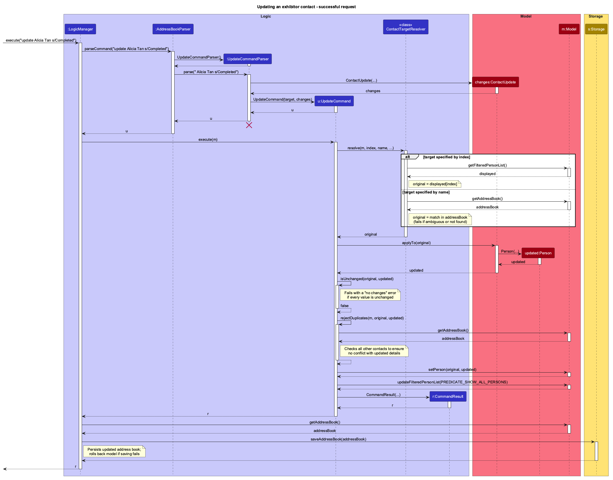
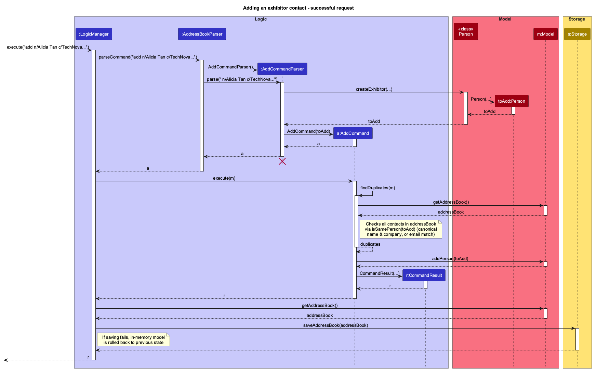

### Project: BoothManagerPro

BoothManagerPro is a desktop contact manager designed for convention organisers managing exhibitor representatives through typed commands, featuring a command-driven UI with static contact cards, robust validation, and multi-field filtering. Adapted from AddressBook-Level 3 (AB3) in Java 25 and JavaFX (~14 kLoC across production and test suites), it replaces generic personal-contact workflows with convention-specific tracking of exhibitor companies, preferred outreach channels, enquiry workflow statuses, and scheduled follow-up dates, backed by local JSON persistence with transactional rollback and corruption-recovery safeguards.

Given below are my contributions to the project.

* **Code contributed**: [RepoSense link](https://nus-cs2103-ay2627-s1.github.io/tp-dashboard/?search=gerardlke&sort=groupTitle&sortWithin=title&timeframe=commit&mergegroup=&groupSelect=groupByRepos&breakdown=true&checkedFileTypes=docs~functional-code~test-code~other)

* **Enhancements implemented**:
  * **New Feature — Exhibitor Contact Domain Model & `add` Workflow** ([PR #66](https://github.com/AY2627S1-CS2103T-W11-2/tp/pull/66), [PR #74](https://github.com/AY2627S1-CS2103T-W11-2/tp/pull/74), [PR #95](https://github.com/AY2627S1-CS2103T-W11-2/tp/pull/95), [PR #189](https://github.com/AY2627S1-CS2103T-W11-2/tp/pull/189)):
    * *What it does:* Implements the core exhibitor domain attributes (`Company`, `ContactMethod`, `EnquiryStatus`, and `FollowUpDate`), JSON serialisation (`JsonAdaptedPerson`), and the `add` command (`add n/NAME c/COMPANY e/EMAIL p/PHONE [m/METHOD] [s/STATUS] [f/YYYYMMDD] [t/TAG]...`) with full-address-book duplicate detection across normalised emails and case-insensitive name-and-company pairs.
    * *Justification:* Convention organisers need to record exhibitor organisations, preferred outreach methods, enquiry workflow stages (`Needs follow-up`, `In progress`, `Completed`, `Cancelled`), and real calendar follow-up dates at creation time, while preventing duplicate representatives even when existing records are hidden by an active search filter.
    * *Highlights:* Extended `Person`, `UniquePersonList`, and `JsonAdaptedPerson` while preserving backward compatibility for legacy records missing optional attributes or addresses (`Not provided`). Designed deterministic error-precedence validation in `AddCommandParser` (checking unknown prefixes and preambles before repeated fields, missing required fields, and ordered value rules) and multi-conflict duplicate reporting in `AddCommand` when an input's email and name/company match two different existing contacts.

  * **New Feature — Partial Contact Modification (`update`)** ([PR #97](https://github.com/AY2627S1-CS2103T-W11-2/tp/pull/97), [PR #178](https://github.com/AY2627S1-CS2103T-W11-2/tp/pull/178), [PR #207](https://github.com/AY2627S1-CS2103T-W11-2/tp/pull/207)):
    * *What it does:* Updates any subset of an exhibitor contact's fields (`update NAME_OR_INDEX ...`), resolving targets either by one-based displayed index or by exact case-insensitive full name across all stored contacts, and supports explicitly clearing optional fields (`m/`, `f/`, `t/`).
    * *Justification:* During convention outreach, organisers routinely advance enquiry statuses, reschedule or clear follow-up dates, or clear preferred contact methods without retyping unchanged fields or running `list` first when a contact's name is unique.
    * *Highlights:* Designed immutable `ContactUpdate` using nested `Optional<Optional<T>>` semantics to cleanly distinguish *omitted* fields (preserve existing value), *blank* fields (explicitly clear to empty), and *supplied* fields (validate and replace), sharing prefix-attributed validation with `add` via `ContactFieldParser`. Implemented no-op detection (accounting for display casing and tag ordering that `Person#equals` ignores) to avoid redundant disk writes, full-book duplicate checks excluding the target record, and retired the overlapping legacy `edit` command to keep the command set cohesive.

  * **Enhancement — Transactional Model Rollback & Confirmation-Guarded `clear confirm`** ([PR #162](https://github.com/AY2627S1-CS2103T-W11-2/tp/pull/162), [PR #178](https://github.com/AY2627S1-CS2103T-W11-2/tp/pull/178)):
    * *What it does:* Snapshots the address book and active filter predicate in `LogicManager` before executing commands and rolls back in-memory mutations if execution or disk persistence (`IOException` / `AccessDeniedException`) fails; requires explicit `clear confirm` before deleting all contacts.
    * *Justification:* Ensures atomic command execution so failed saves never leave unpersisted state in memory that could leak into subsequent commands (later extended by teammate Wenze in [PR #194](https://github.com/AY2627S1-CS2103T-W11-2/tp/pull/194) to also restore active sort comparators), and prevents accidental single-word `clear` wipes.

  * **Enhancement — Resilient Prefix Tokenization, Input Guardrails & Parser Error Specificity** ([PR #162](https://github.com/AY2627S1-CS2103T-W11-2/tp/pull/162), [PR #201](https://github.com/AY2627S1-CS2103T-W11-2/tp/pull/201), [PR #207](https://github.com/AY2627S1-CS2103T-W11-2/tp/pull/207)):
    * *What it does:* Accepts slashes inside multi-word values (e.g. `Acme Design/ Build`) and common business slash abbreviations inside `c/` (`t/a`, `d/b/a`, `c/o`, `M/s`, `S/B`, `P/L`, `I/O`, `A/B`); accepts case-insensitive command words and field prefixes across all commands; enforces NFC Unicode normalisation and attribute length/regex guardrails; and reports specific parser errors across commands.
    * *Justification:* Real exhibitor company names often contain slash abbreviations that naive `/` splitting rejects, minor capitalisation differences in commands or prefixes (`List`, `ADD`, `N/`) should not interrupt CLI entry, and adversarial or malformed inputs must fail fast with actionable messages.
    * *Highlights:* Eliminated catastrophic regex backtracking (ReDoS) in `Email` validation with timeout regression tests; implemented context-aware lookahead rules in `ArgumentTokenizer` so `t/a Acme Events` inside `c/` stays part of the company while standalone `t/a` remains a tag; unified NFC Unicode + whitespace normalisation across `Name` and `Company` duplicate and search checks; and distinguished signed (`+1`), non-positive (`0`, `-1`), integer-overflow, and multi-index (`1 2`) targets in `ParserUtil` alongside prefix-attributed validation in `FindCommandParser`.

  * **Enhancement — `CommandBox` `Tab` Autocomplete, Keyboard Focus & UI Polish** ([PR #52](https://github.com/AY2627S1-CS2103T-W11-2/tp/pull/52), [PR #56](https://github.com/AY2627S1-CS2103T-W11-2/tp/pull/56), [PR #66](https://github.com/AY2627S1-CS2103T-W11-2/tp/pull/66), [PR #181](https://github.com/AY2627S1-CS2103T-W11-2/tp/pull/181), [PR #201](https://github.com/AY2627S1-CS2103T-W11-2/tp/pull/201), [PR #207](https://github.com/AY2627S1-CS2103T-W11-2/tp/pull/207)):
    * *What it does:* Completes unambiguous command words, missing required `add` prefixes (including reordered inputs), partial field prefixes, and fixed-choice values (`m/`, `s/`, `o/`) case-insensitively; preserves `TextField` undo history (`Ctrl+Z`); releases `Tab` focus to `ResultDisplay` when no completion applies; preserves pending numbered `view` choices across `help` / `F1`; formats `FollowUpDate` display as `d MMM uuuu`; and recovers off-screen or oversized saved windows via `WindowPlacement`.

  * **Testing, Logging & Defensive Assertions** ([PR #115](https://github.com/AY2627S1-CS2103T-W11-2/tp/pull/115), [PR #189](https://github.com/AY2627S1-CS2103T-W11-2/tp/pull/189), [PR #191](https://github.com/AY2627S1-CS2103T-W11-2/tp/pull/191)):
    * Authored comprehensive unit, integration, and headless JavaFX UI tests (`ExhibitorAddIntegrationTest`, `UpdateIntegrationTest`, `CompanyTest`, `ContactMethodTest`, `ContactUpdateTest`, `EnquiryStatusTest`, `FollowUpDateTest`, `UpdateCommandTest`, `TagCommandTest`, `MessagesTest`, `ClearCommandParserTest`, `WindowPlacementTest`), added `LogsCenter` tracing for `add` and `update`, and enforced runtime `assert` invariants across `LogicManager` and commands.

* **Contributions to the User Guide**:
  * Authored and maintained the **Adding an exhibitor contact (`add`)**, **Updating an exhibitor contact (`update`)**, and **Clearing all entries (`clear confirm`)** sections, including field validation rules, duplicate-handling specifications, field-clearing rules, and the `add` input-error troubleshooting table ([PR #66](https://github.com/AY2627S1-CS2103T-W11-2/tp/pull/66), [PR #74](https://github.com/AY2627S1-CS2103T-W11-2/tp/pull/74), [PR #95](https://github.com/AY2627S1-CS2103T-W11-2/tp/pull/95), [PR #97](https://github.com/AY2627S1-CS2103T-W11-2/tp/pull/97), [PR #178](https://github.com/AY2627S1-CS2103T-W11-2/tp/pull/178), [PR #207](https://github.com/AY2627S1-CS2103T-W11-2/tp/pull/207)).
  * Updated command format notes (case-insensitivity of command words and prefixes, extraneous parameter rules), company slash-abbreviation rules, target/index error guidance across `delete`/`update`/`tag`/`view`, and early UI screenshots ([PR #91](https://github.com/AY2627S1-CS2103T-W11-2/tp/pull/91), [PR #201](https://github.com/AY2627S1-CS2103T-W11-2/tp/pull/201), [PR #207](https://github.com/AY2627S1-CS2103T-W11-2/tp/pull/207)).

* **Contributions to the Developer Guide**:
  * Authored the **User Stories** section (`US-01` to `US-35`), priority tiers, planned/considered/out-of-scope classifications, and cross-referenced scope notes ([PR #29](https://github.com/AY2627S1-CS2103T-W11-2/tp/pull/29)).
  * Authored the **Adding an exhibitor contact** and **Updating an exhibitor contact** implementation sections, shared contact attribute contracts, error-handling responsibilities, integration notes, and manual testing instructions (`Testing exhibitor additions`, `Clearing all contacts`, and parser error checks) ([PR #66](https://github.com/AY2627S1-CS2103T-W11-2/tp/pull/66), [PR #95](https://github.com/AY2627S1-CS2103T-W11-2/tp/pull/95), [PR #97](https://github.com/AY2627S1-CS2103T-W11-2/tp/pull/97), [PR #201](https://github.com/AY2627S1-CS2103T-W11-2/tp/pull/201), [PR #207](https://github.com/AY2627S1-CS2103T-W11-2/tp/pull/207)).
  * **UML Diagrams added/updated**:
    * Added `AddSequenceDiagram.puml` (`images/AddSequenceDiagram.png`) for the `add` workflow ([PR #165](https://github.com/AY2627S1-CS2103T-W11-2/tp/pull/165)).
    * Added `UpdateSequenceDiagram.puml` (`images/UpdateSequenceDiagram.png`) for dual index/name target resolution and partial updates in `update` ([PR #165](https://github.com/AY2627S1-CS2103T-W11-2/tp/pull/165)).
    * Updated `ModelClassDiagram.puml` (`images/ModelClassDiagram.png`) to incorporate `Company`, `ContactMethod`, `EnquiryStatus`, and `FollowUpDate` ([PR #115](https://github.com/AY2627S1-CS2103T-W11-2/tp/pull/115)).

* **Contributions to team-based tasks**:
  * Refactored the codebase package namespace from `seedu.address` to `seedu.boothmanagerpro` and removed tracked `bin/` build artifacts ([PR #51](https://github.com/AY2627S1-CS2103T-W11-2/tp/pull/51), [PR #66](https://github.com/AY2627S1-CS2103T-W11-2/tp/pull/66)).
  * Set up GitHub Actions CI status and Codecov badges, added Linux Codecov CI checks, enabled Gradle runtime assertions, populated realistic exhibitor `SampleDataUtil` contacts, and maintained `README.md` and `docs/index.md` ([PR #27](https://github.com/AY2627S1-CS2103T-W11-2/tp/pull/27), [PR #52](https://github.com/AY2627S1-CS2103T-W11-2/tp/pull/52), [PR #115](https://github.com/AY2627S1-CS2103T-W11-2/tp/pull/115), [PR #189](https://github.com/AY2627S1-CS2103T-W11-2/tp/pull/189)).
  * Coordinated `v1.2` cross-feature attribute alignment across `add`, `find`, `view`, `list`, and `delete` ([PR #71](https://github.com/AY2627S1-CS2103T-W11-2/tp/pull/71)).

* **Review/mentoring contributions**:
  * Reviewed, verified CI/coverage compliance, resolved cross-branch merge conflicts, and merged **30+ teammate pull requests** across `v1.1`–`v1.5`:
    * Feature & UI PRs: [#62](https://github.com/AY2627S1-CS2103T-W11-2/tp/pull/62), [#67](https://github.com/AY2627S1-CS2103T-W11-2/tp/pull/67), [#81](https://github.com/AY2627S1-CS2103T-W11-2/tp/pull/81), [#101](https://github.com/AY2627S1-CS2103T-W11-2/tp/pull/101), [#103](https://github.com/AY2627S1-CS2103T-W11-2/tp/pull/103), [#110](https://github.com/AY2627S1-CS2103T-W11-2/tp/pull/110), [#121](https://github.com/AY2627S1-CS2103T-W11-2/tp/pull/121)
    * Bug-fix & storage PRs: [#160](https://github.com/AY2627S1-CS2103T-W11-2/tp/pull/160), [#161](https://github.com/AY2627S1-CS2103T-W11-2/tp/pull/161), [#164](https://github.com/AY2627S1-CS2103T-W11-2/tp/pull/164), [#176](https://github.com/AY2627S1-CS2103T-W11-2/tp/pull/176), [#179](https://github.com/AY2627S1-CS2103T-W11-2/tp/pull/179), [#182](https://github.com/AY2627S1-CS2103T-W11-2/tp/pull/182), [#185](https://github.com/AY2627S1-CS2103T-W11-2/tp/pull/185), [#187](https://github.com/AY2627S1-CS2103T-W11-2/tp/pull/187), [#195](https://github.com/AY2627S1-CS2103T-W11-2/tp/pull/195), [#205](https://github.com/AY2627S1-CS2103T-W11-2/tp/pull/205), [#220](https://github.com/AY2627S1-CS2103T-W11-2/tp/pull/220), [#223](https://github.com/AY2627S1-CS2103T-W11-2/tp/pull/223)
    * Documentation & UML PRs: [#30](https://github.com/AY2627S1-CS2103T-W11-2/tp/pull/30), [#32](https://github.com/AY2627S1-CS2103T-W11-2/tp/pull/32), [#34](https://github.com/AY2627S1-CS2103T-W11-2/tp/pull/34), [#39](https://github.com/AY2627S1-CS2103T-W11-2/tp/pull/39), [#45](https://github.com/AY2627S1-CS2103T-W11-2/tp/pull/45), [#46](https://github.com/AY2627S1-CS2103T-W11-2/tp/pull/46), [#134](https://github.com/AY2627S1-CS2103T-W11-2/tp/pull/134), [#137](https://github.com/AY2627S1-CS2103T-W11-2/tp/pull/137), [#149](https://github.com/AY2627S1-CS2103T-W11-2/tp/pull/149), [#184](https://github.com/AY2627S1-CS2103T-W11-2/tp/pull/184), [#196](https://github.com/AY2627S1-CS2103T-W11-2/tp/pull/196), [#198](https://github.com/AY2627S1-CS2103T-W11-2/tp/pull/198), [#215](https://github.com/AY2627S1-CS2103T-W11-2/tp/pull/215), [#218](https://github.com/AY2627S1-CS2103T-W11-2/tp/pull/218)

--------------------------------------------------------------------------------------------------------------------

### Contributions to the Developer Guide (Extracts)

#### Updating an exhibitor contact

`update NAME_OR_INDEX [n/NAME] [c/COMPANY] [e/EMAIL] [p/PHONE] [m/METHOD] [s/STATUS] [f/YYYYMMDD] [t/TAG]...`

1. `AddressBookParser` routes `update` to `UpdateCommandParser`, which validates the target, field cardinality, and supplied values.
2. `ContactFieldParser` shares prefix-specific validation feedback with `add`; domain value types remain the source of constraints and normalisation.
3. Immutable `ContactUpdate` represents partial changes. An absent optional preserves the value; a present empty contact method, date, or tag set explicitly clears it. Tags are defensively copied.
4. `UpdateCommand` resolves an exact case-insensitive full name across all contacts or a one-based index in the current displayed list. Missing or ambiguous targets fail before mutation.
5. The command constructs a replacement `Person` via `ContactUpdate#applyTo`. If all stored values are unchanged, it throws `CommandException` with a no-change message before mutation or persistence. Otherwise, it checks every other contact for duplicate email or name/company, including hidden records, before calling `Model#setPerson` and resetting the filter.

#### Adding an exhibitor contact (Sequence Diagram)

--------------------------------------------------------------------------------------------------------------------

### Contributions to the User Guide (Extracts)

#### Updating an exhibitor contact: `update`

Format: `update NAME_OR_INDEX [n/NAME] [c/COMPANY] [e/EMAIL] [p/PHONE] [m/METHOD] [s/STATUS] [f/YYYYMMDD] [t/TAG]...`

* Use an exact full name, ignoring case, or a displayed index from `list`, `find`, or `view` (`update 2 s/In progress`). Name lookup includes contacts hidden by a filter.
* Supply at least one field. Omitted attributes stay unchanged. `n/` changes the name; the text before the first prefix selects the original contact.
* Only `t/` may repeat. Supplied tags replace existing tags, with duplicates ignored in input order. Empty `t/` clears tags; empty `m/` clears the preferred contact method back to `Not specified`; empty `f/` clears the follow-up date. Other blank fields are rejected.
* Supplying only existing values reports `No changes made: NAME at COMPANY already has the supplied values.` without modifying the current filter, sort order, or saved file.
