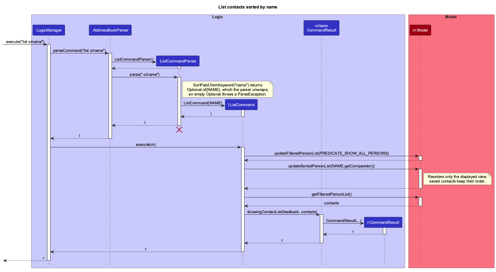

### Project: BoothManagerPro

BoothManagerPro is a desktop contact manager designed for convention organisers managing exhibitor representatives through typed commands, featuring a command-driven UI with static contact cards, robust validation, and multi-field filtering. It is adapted from AddressBook-Level 3 (AB3) in Java 25 and JavaFX, with local JSON storage.

Given below are my contributions to the project.

* **Code contributed**: [RepoSense link](https://nus-cs2103-ay2627-s1.github.io/tp-dashboard/?search=jennangke&sort=groupTitle&sortWithin=title&timeframe=commit&mergegroup=&groupSelect=groupByRepos&breakdown=true&checkedFileTypes=docs~functional-code~test-code~other)

* **Enhancements implemented**:
  * **New Feature: `list` command and contact sorting** ([PR #69](https://github.com/AY2627S1-CS2103T-W11-2/tp/pull/69), [PR #103](https://github.com/AY2627S1-CS2103T-W11-2/tp/pull/103), [PR #125](https://github.com/AY2627S1-CS2103T-W11-2/tp/pull/125)):
    * *What it does:* `list` shows every contact with all exhibitor details and a total. `list o/name`, `list o/company` and `list o/status` sort the displayed contacts.
    * *Justification:* Organisers need to scan many exhibitors in a predictable order. Sorting by status puts contacts that need follow-up first, following the enquiry workflow rather than the alphabet.
    * *Highlights:* I wrapped the `FilteredList` in a JavaFX `SortedList`, so saved data keeps its original order while `delete`, `update` and `tag` use the same numbers the user sees. Every `SortField` comparator ends with the unique email, so contacts never tie and indices stay stable. The sort order persists through later `find`, `add`, `update` and `tag` commands until a plain `list`, which also needed a design that kept filtering and sorting independent.

  * **Enhancement: Contact cards and status badges** ([PR #79](https://github.com/AY2627S1-CS2103T-W11-2/tp/pull/79), [PR #89](https://github.com/AY2627S1-CS2103T-W11-2/tp/pull/89), [PR #105](https://github.com/AY2627S1-CS2103T-W11-2/tp/pull/105)):
    * *What it does:* `list`, `find` and `view` show contacts as cards in the output area. Each card has a colour-coded enquiry status badge and a matching left edge.
    * *Justification:* The target user types quickly but still has to read many fields, and status is the field that decides who to contact next.
    * *Highlights:* Results carry their contacts in `CommandResult`, so the UI renders cards without separate list panels or selection state. I also made the contact total appear only for `list` results.

  * **Enhancement: Parser error messages and validation** ([PR #187](https://github.com/AY2627S1-CS2103T-W11-2/tp/pull/187)):
    * *What it does:* Replaces generic or misleading errors with specific ones for zero, negative and overflowing indexes, `n/` misuse in `delete`, `update` and `tag`, `view` with a missing prefix or empty name, and disallowed phone characters.
    * *Justification:* Fast typists fix a command from its error message, so the message must describe the actual mistake. For example, `update -1 s/Completed` used to report a name-format error.
    * *Highlights:* Index checks and messages are shared through `ParserUtil`, so the commands stay consistent. I refactored `ViewCommandParser` from a hand-written regex to `ArgumentTokenizer` with short methods, keeping its existing behaviour apart from the intended message fixes. I also added dedicated unit tests for the tag, update and contact field parsers, with shared test helpers to avoid duplication.

  * **Enhancement: Labelled phone numbers** ([PR #233](https://github.com/AY2627S1-CS2103T-W11-2/tp/pull/233)):
    * *What it does:* Accepts a bracketed label after each number, e.g. `9123 4567 (HP) / 6123 4567 (Office)`.
    * *Justification:* Exhibitor representatives often give several numbers, and organisers need to know which is which.
    * *Highlights:* `Phone` remains a single validated string, so the JSON format is unchanged. Labels had to stay separate from area codes such as `(65)`, not count towards the 7-15 digit limit, and not affect `find`. The validation stays linear-time on long malformed input, and misplaced labels get an accurate error message rather than a misleading digit-count error.

  * **Bug fixes: Data safety and storage recovery** ([PR #211](https://github.com/AY2627S1-CS2103T-W11-2/tp/pull/211)):
    * Read-only commands no longer overwrite a data file that failed to load, and they no longer fail when the data folder is read-only.
    * A failed first save no longer leaves an empty data file, which had caused false concurrent-modification errors and treated the next launch as corrupted data.
    * The recovery backup is now made only after the concurrent-modification check passes, `{"guiSettings": null}` no longer crashes startup, and whitespace in the hidden legacy address no longer rejects a whole data file.
    * Each fix has tests, which I confirmed fail against the old code. Several existing tests had encoded the old behaviour and needed rewriting while keeping their original intent.

  * **Bug fixes: `view` and command box** ([PR #164](https://github.com/AY2627S1-CS2103T-W11-2/tp/pull/164), [PR #180](https://github.com/AY2627S1-CS2103T-W11-2/tp/pull/180)):
    * Exact full names now show that contact directly, so overlapping names such as `Alex Yeo` and `Alex Yeoh` are handled.
    * `view` choices are numbered in the displayed order. Previously, after sorting, `update 2` could change a different contact from the one numbered 2 in the prompt.
    * An invalid `view` reply now repeats the numbered choices, and `find` gained autofill.
    * Typed input is no longer lost when focus returns to the command box. JavaFX selects all text after focus changes, so the fix listens to the scene's focus owner and moves the caret afterwards. It covers Tab, F1 and the focus shortcut.

* **Contributions to the User Guide**:
  * Wrote the `list` command section, including sorting rules and the expected output.
  * Documented the parser error messages for `view`, `update`, `tag` and `delete`, and the phone rules and error messages, including labels.
  * Updated the Tab, focus and `view` behaviour notes, and the guidance on when data is saved.
  * Corrected stale `find`, phone and command-format content across the guide ([PR #212](https://github.com/AY2627S1-CS2103T-W11-2/tp/pull/212)).

* **Contributions to the Developer Guide**:
  * Wrote the "Sorting the contact list" implementation section, including design alternatives.
  * Added the "Testing parser error messages" manual tests, and updated the corrupted-data manual tests.
  * Updated the Glossary ([PR #39](https://github.com/AY2627S1-CS2103T-W11-2/tp/pull/39)), and the user stories and use cases for `find` ([PR #212](https://github.com/AY2627S1-CS2103T-W11-2/tp/pull/212)).
  * **UML diagrams added or rendered:** `ListSortSequenceDiagram` and `AddSequenceDiagram`.
  * **UML diagrams updated** ([PR #126](https://github.com/AY2627S1-CS2103T-W11-2/tp/pull/126), [PR #213](https://github.com/AY2627S1-CS2103T-W11-2/tp/pull/213)): `UiClassDiagram`, `ModelClassDiagram`, `StorageClassDiagram`, `ParserClasses`, `FindFollowUpDateSequence` and `UpdateSequenceDiagram`, checking each against the code and removing unused AB3 diagrams.

* **Contributions to team-based tasks**:
  * Published the [v1.3 release](https://github.com/AY2627S1-CS2103T-W11-2/tp/releases/tag/v1.3).
  * Audited the docs and diagrams against the code before release ([#209](https://github.com/AY2627S1-CS2103T-W11-2/tp/issues/209), [#204](https://github.com/AY2627S1-CS2103T-W11-2/tp/issues/204)).
  * Improved code quality across list output and contact cards ([PR #123](https://github.com/AY2627S1-CS2103T-W11-2/tp/pull/123)).
  * Reported bugs found during team testing ([#138](https://github.com/AY2627S1-CS2103T-W11-2/tp/issues/138), [#139](https://github.com/AY2627S1-CS2103T-W11-2/tp/issues/139), [#140](https://github.com/AY2627S1-CS2103T-W11-2/tp/issues/140), [#141](https://github.com/AY2627S1-CS2103T-W11-2/tp/issues/141), [#142](https://github.com/AY2627S1-CS2103T-W11-2/tp/issues/142), [#143](https://github.com/AY2627S1-CS2103T-W11-2/tp/issues/143)).

* **Review/mentoring contributions**:
  * Reviewed and approved 14 PRs by teammates, with inline comments on [PR #56](https://github.com/AY2627S1-CS2103T-W11-2/tp/pull/56), [PR #91](https://github.com/AY2627S1-CS2103T-W11-2/tp/pull/91), [PR #112](https://github.com/AY2627S1-CS2103T-W11-2/tp/pull/112), [PR #114](https://github.com/AY2627S1-CS2103T-W11-2/tp/pull/114), [PR #118](https://github.com/AY2627S1-CS2103T-W11-2/tp/pull/118) and [PR #162](https://github.com/AY2627S1-CS2103T-W11-2/tp/pull/162).
  * Others reviewed: [PR #51](https://github.com/AY2627S1-CS2103T-W11-2/tp/pull/51), [PR #52](https://github.com/AY2627S1-CS2103T-W11-2/tp/pull/52), [PR #71](https://github.com/AY2627S1-CS2103T-W11-2/tp/pull/71), [PR #74](https://github.com/AY2627S1-CS2103T-W11-2/tp/pull/74), [PR #210](https://github.com/AY2627S1-CS2103T-W11-2/tp/pull/210) and [PR #235](https://github.com/AY2627S1-CS2103T-W11-2/tp/pull/235).

--------------------------------------------------------------------------------------------------------------------

### Contributions to the Developer Guide (Extracts)

#### Sorting the contact list

The sequence diagram below shows how `list o/name` is executed.

--------------------------------------------------------------------------------------------------------------------

### Contributions to the User Guide (Extracts)

#### Listing all exhibitor contacts: `list`

* `list` with no parameters shows contacts in the order they were added.
* `list o/name` sorts contacts alphabetically by name. Contacts with the same name are ordered by company, then by email.
* `list o/status` sorts contacts by enquiry status in workflow order: `Needs follow-up` first, then `In progress`, then `Completed`, then `Cancelled`, so the contacts you still need to act on come first.
* Sorting changes only the displayed order, not the saved data. The numbers shown follow the sorted order, so `list o/name` followed by `delete 1` deletes the first contact alphabetically.
